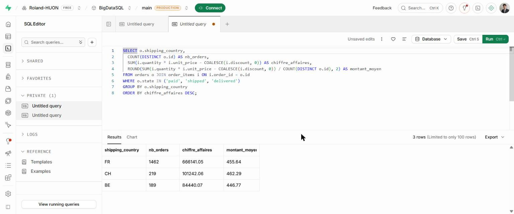
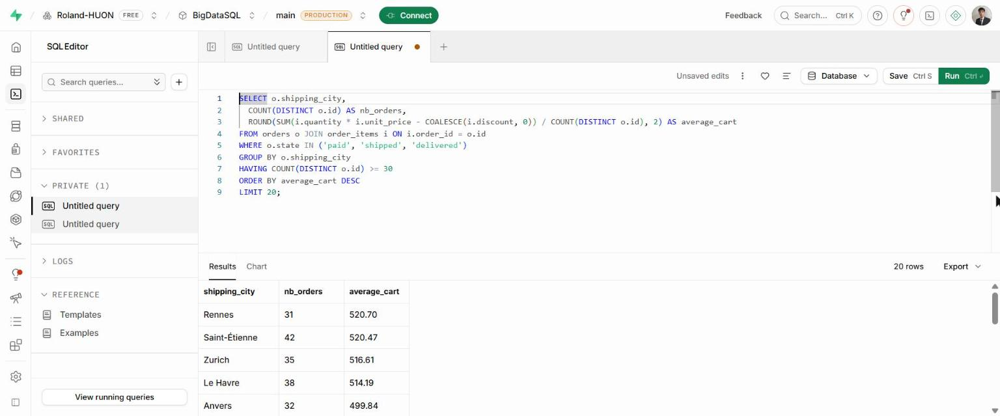
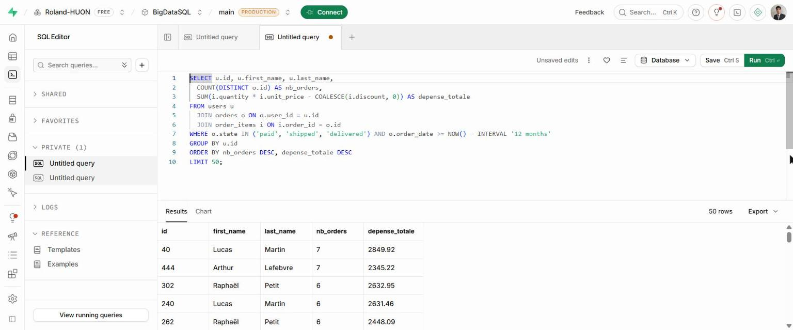
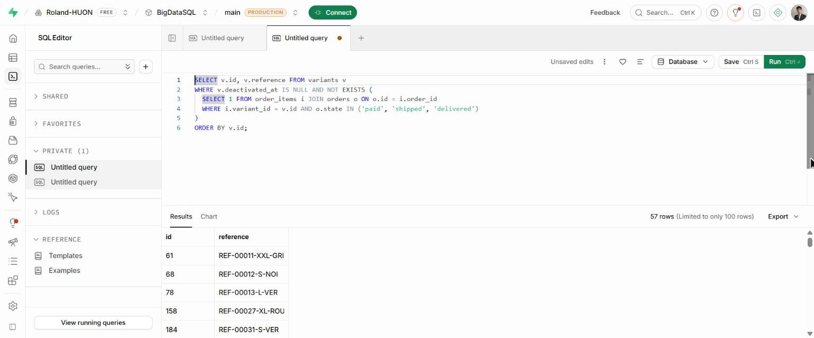
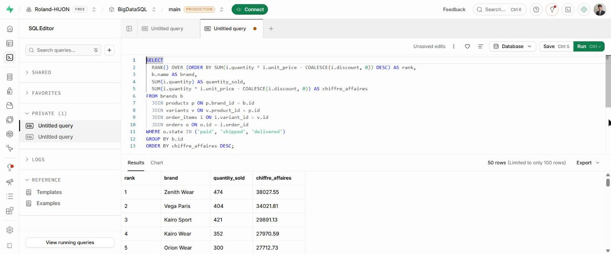
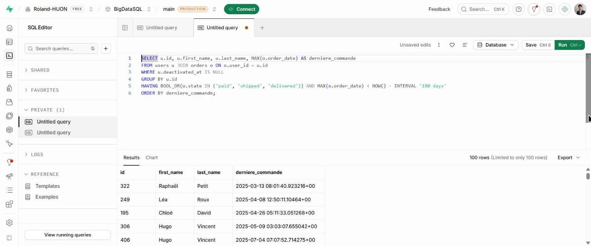
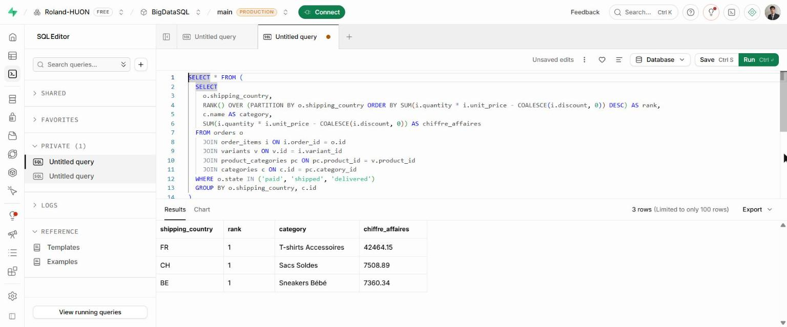
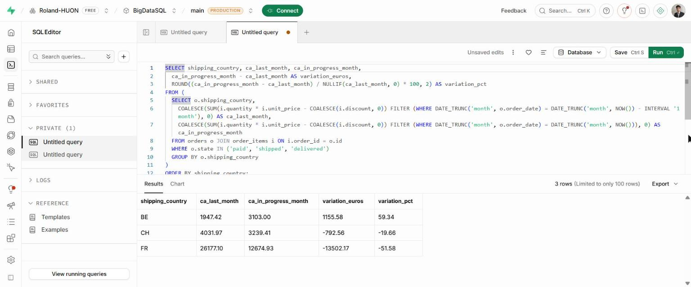
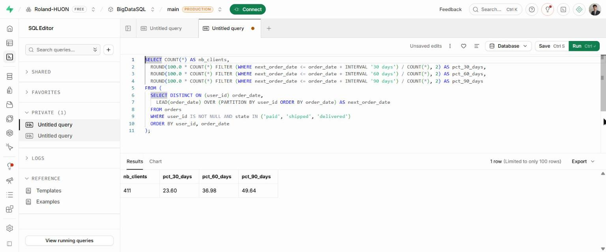
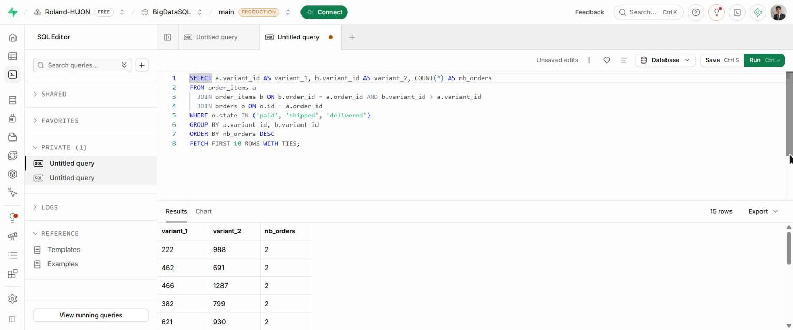

## Personne

- Roland HUON

## Défi SQL 01

"Quel est le montant moyen d'une commande validée dans chaque pays de livraison ? Comparez le nombre de commandes et le chiffre d'affaires."

### Code SQL :

```sql
SELECT o.shipping_country,
  COUNT(DISTINCT o.id) AS nb_orders,
  SUM(i.quantity * i.unit_price - COALESCE(i.discount, 0)) AS chiffre_affaires,
  ROUND(SUM(i.quantity * i.unit_price - COALESCE(i.discount, 0)) / COUNT(DISTINCT o.id), 2) AS montant_moyen
FROM orders o JOIN order_items i ON i.order_id = o.id
WHERE o.state IN ('paid', 'shipped', 'delivered')
GROUP BY o.shipping_country
ORDER BY chiffre_affaires DESC;
```

### Résultat :

| shipping_country | nb_orders | chiffre_affaires | montant_moyen |
|---|---|---|---|
| FR | 1462 | 666141.05 € | 455.64 € |
| CH | 219 | 101242.06 € | 462.29 € |
| BE | 189 | 84440.07 € | 446.77 € |

### Image du résultat



## Défi SQL 02

"Quelles sont les 20 villes au panier moyen le plus élevé, parmi celles ayant au moins 30 commandes ?"

### Code SQL :

```sql
SELECT o.shipping_city,
  COUNT(DISTINCT o.id) AS nb_orders,
  ROUND(SUM(i.quantity * i.unit_price - COALESCE(i.discount, 0)) / COUNT(DISTINCT o.id), 2) AS average_cart
FROM orders o JOIN order_items i ON i.order_id = o.id
WHERE o.state IN ('paid', 'shipped', 'delivered')
GROUP BY o.shipping_city
HAVING COUNT(DISTINCT o.id) >= 30
ORDER BY average_cart DESC
LIMIT 20;
```

### Résultat :

| shipping_city | nb_orders | average_cart |
|---|---|---|
| Rennes | 31 | 520.70 € |
| Saint-Étienne | 42 | 520.47 € |
| Zurich | 35 | 516.61 € |
| Le Havre | 38 | 514.19 € |
| Anvers | 32 | 499.84 € |
| Nice | 74 | 494.08 € |
| Le Mans | 32 | 492.61 € |
| Paris | 211 | 490.65 € |
| Annecy | 42 | 488.81 € |
| Brest | 32 | 488.64 € |
| Lausanne | 33 | 482.08 € |
| Limoges | 30 | 474.04 € |
| Nîmes | 45 | 473.79 € |
| Nantes | 78 | 467.69 € |
| Genève | 58 | 461.31 € |
| Lille | 53 | 456.78 € |
| Aix-en-Provence | 30 | 452.65 € |
| Montpellier | 78 | 451.96 € |
| Angers | 47 | 451.73 € |
| Strasbourg | 46 | 448.99 € |

### Image du résultat



## Défi SQL 03

"Quels sont les 50 clients avec le plus de commandes payées sur 12 mois ? Affichez aussi leur dépense totale."

### Code SQL :

```sql
SELECT u.id, u.first_name, u.last_name,
  COUNT(DISTINCT o.id) AS nb_orders,
  SUM(i.quantity * i.unit_price - COALESCE(i.discount, 0)) AS depense_totale
FROM users u
  JOIN orders o ON o.user_id = u.id
  JOIN order_items i ON i.order_id = o.id
WHERE o.state IN ('paid', 'shipped', 'delivered') AND o.order_date >= NOW() - INTERVAL '12 months'
GROUP BY u.id
ORDER BY nb_orders DESC, depense_totale DESC
LIMIT 50;
```

### Résultat :

| id | first_name | last_name | nb_orders | depense_totale |
|---|---|---|---|---|
| 40 | Lucas | Martin | 7 | 2849.92 € |
| 444 | Arthur | Lefebvre | 7 | 2345.22 € |
| 302 | Raphaël | Petit | 6 | 2632.95 € |
| 240 | Lucas | Martin | 6 | 2631.46 € |
| 262 | Raphaël | Petit | 6 | 2448.09 € |
| 206 | Hugo | Vincent | 6 | 1903.73 € |
| 221 | Manon | Michel | 6 | 1722.43 € |
| 222 | Raphaël | Petit | 5 | 2500.92 € |
| 226 | Hugo | Vincent | 5 | 2357.32 € |
| 246 | Hugo | Vincent | 5 | 2269.87 € |

*10 premières lignes sur 50.*

### Image du résultat



## Défi SQL 04

"Quelles variantes actives du catalogue n'ont jamais été achetées ?"

### Code SQL :

```sql
SELECT v.id, v.reference FROM variants v
WHERE v.deactivated_at IS NULL AND NOT EXISTS (
  SELECT 1 FROM order_items i JOIN orders o ON o.id = i.order_id
  WHERE i.variant_id = v.id AND o.state IN ('paid', 'shipped', 'delivered')
)
ORDER BY v.id;
```

### Résultat :

| id | reference |
|---|---|
| 61 | REF-00011-XXL-GRI |
| 68 | REF-00012-S-NOI |
| 78 | REF-00013-L-VER |
| 158 | REF-00027-XL-ROU |
| 184 | REF-00031-S-VER |
| 187 | REF-00032-M-BLE |
| 221 | REF-00037-M-VER |
| 229 | REF-00039-L-ROU |
| 248 | REF-00042-S-NOI |
| 249 | REF-00042-M-NOI |

*10 premières lignes sur 57.*

### Image du résultat



## Défi SQL 05

"Classez les marques par chiffre d'affaires en tenant compte des quantités et des prix réellement payés."

### Code SQL :

```sql
SELECT
  RANK() OVER (ORDER BY SUM(i.quantity * i.unit_price - COALESCE(i.discount, 0)) DESC) AS rank,
  b.name AS brand,
  SUM(i.quantity) AS quantity_sold,
  SUM(i.quantity * i.unit_price - COALESCE(i.discount, 0)) AS chiffre_affaires
FROM brands b
  JOIN products p ON p.brand_id = b.id
  JOIN variants v ON v.product_id = p.id
  JOIN order_items i ON i.variant_id = v.id
  JOIN orders o ON o.id = i.order_id
WHERE o.state IN ('paid', 'shipped', 'delivered')
GROUP BY b.id
ORDER BY chiffre_affaires DESC;
```

### Résultat :

| rank | brand | quantity_sold | chiffre_affaires |
|---|---|---|---|
| 1 | Zenith Wear | 474 | 38027.55 € |
| 2 | Vega Paris | 404 | 34021.81 € |
| 3 | Kairo Sport | 421 | 29891.13 € |
| 4 | Kairo Wear | 352 | 27970.59 € |
| 5 | Orion Wear | 300 | 27712.73 € |
| 6 | Atlas Paris | 373 | 27600.93 € |
| 7 | Zenith Sport | 357 | 26661.74 € |
| 8 | Atlas Outdoor | 323 | 26149.00 € |
| 9 | Nordik Wear | 370 | 25365.61 € |
| 10 | Nova Outdoor | 297 | 24691.57 € |

*10 premières lignes sur 50.*

### Image du résultat



## Défi SQL 07

"Quels clients ayant déjà acheté n'ont rien commandé depuis 180 jours ?"

### Code SQL :

```sql
SELECT u.id, u.first_name, u.last_name, MAX(o.order_date) AS derniere_commande
FROM users u JOIN orders o ON o.user_id = u.id
WHERE u.deactivated_at IS NULL
GROUP BY u.id
HAVING BOOL_OR(o.state IN ('paid', 'shipped', 'delivered')) AND MAX(o.order_date) < NOW() - INTERVAL '180 days'
ORDER BY derniere_commande;
```

### Résultat :

| id | first_name | last_name | derniere_commande |
|---|---|---|---|
| 322 | Raphaël | Petit | 2025-03-13 |
| 249 | Léa | Roux | 2025-04-08 |
| 195 | Chloé | David | 2025-04-26 |
| 306 | Hugo | Vincent | 2025-05-09 |
| 406 | Hugo | Vincent | 2025-07-04 |
| 443 | Emma | Fournier | 2025-07-19 |
| 455 | Chloé | David | 2025-07-21 |
| 391 | Louise | Thomas | 2025-07-21 |
| 105 | Jade | Richard | 2025-08-20 |
| 23 | Emma | Fournier | 2025-08-23 |

*10 premières lignes sur 115.*

*L'éditeur SQL de Supabase limite l'affichage à 100 lignes : la requête renvoie 115 clients au total.*

### Image du résultat



## Défi SQL 08

"Quelle catégorie réalise le plus de ventes dans chaque pays ? Un produit peut appartenir à plusieurs catégories."

### Code SQL :

```sql
SELECT * FROM (
  SELECT 
    o.shipping_country,
    RANK() OVER (PARTITION BY o.shipping_country ORDER BY SUM(i.quantity * i.unit_price - COALESCE(i.discount, 0)) DESC) AS rank, 
    c.name AS category,
    SUM(i.quantity * i.unit_price - COALESCE(i.discount, 0)) AS chiffre_affaires
  FROM orders o
    JOIN order_items i ON i.order_id = o.id
    JOIN variants v ON v.id = i.variant_id
    JOIN product_categories pc ON pc.product_id = v.product_id
    JOIN categories c ON c.id = pc.category_id
  WHERE o.state IN ('paid', 'shipped', 'delivered')
  GROUP BY o.shipping_country, c.id
)
WHERE rank = 1
ORDER BY chiffre_affaires DESC;
```

### Résultat :

| shipping_country | rank | category | chiffre_affaires |
|---|---|---|---|
| FR | 1 | T-shirts Accessoires | 42464.15 € |
| CH | 1 | Sacs Soldes | 7508.89 € |
| BE | 1 | Sneakers Bébé | 7360.34 € |

### Image du résultat



## Défi SQL 18

"Quelle est la variation en euros et en pourcentage du CA par pays par rapport au mois précédent, y compris les mois à zéro ?"

### Code SQL :

```sql
SELECT shipping_country, ca_last_month, ca_in_progress_month, 
  ca_in_progress_month - ca_last_month AS variation_euros,
  ROUND((ca_in_progress_month - ca_last_month) / NULLIF(ca_last_month, 0) * 100, 2) AS variation_pct
FROM (
  SELECT o.shipping_country,
    COALESCE(SUM(i.quantity * i.unit_price - COALESCE(i.discount, 0)) FILTER (WHERE DATE_TRUNC('month', o.order_date) = DATE_TRUNC('month', NOW()) - INTERVAL '1 month'), 0) AS ca_last_month,
    COALESCE(SUM(i.quantity * i.unit_price - COALESCE(i.discount, 0)) FILTER (WHERE DATE_TRUNC('month', o.order_date) = DATE_TRUNC('month', NOW())), 0) AS ca_in_progress_month
  FROM orders o JOIN order_items i ON i.order_id = o.id
  WHERE o.state IN ('paid', 'shipped', 'delivered')
  GROUP BY o.shipping_country
)
ORDER BY shipping_country;
```

### Résultat :

| shipping_country | ca_last_month | ca_in_progress_month | variation_euros | variation_pct |
|---|---|---|---|---|
| BE | 1947.42 € | 3103.00 € | 1155.58 € | 59.34 % |
| CH | 4031.97 € | 3239.41 € | -792.56 € | -19.66 % |
| FR | 26177.10 € | 12674.93 € | -13502.17 € | -51.58 % |

*Mois précédent = octobre 2026, mois en cours = novembre 2026 (jusqu'au 19 novembre au moment de l'exécution).*

### Image du résultat



## Défi SQL 19

"Quelle proportion des clients repasse commande dans les 30, 60 et 90 jours après leur premier achat ?"

### Code SQL :

```sql
SELECT COUNT(*) AS nb_clients,
  ROUND(100.0 * COUNT(*) FILTER (WHERE next_order_date <= order_date + INTERVAL '30 days') / COUNT(*), 2) AS pct_30_days,
  ROUND(100.0 * COUNT(*) FILTER (WHERE next_order_date <= order_date + INTERVAL '60 days') / COUNT(*), 2) AS pct_60_days,
  ROUND(100.0 * COUNT(*) FILTER (WHERE next_order_date <= order_date + INTERVAL '90 days') / COUNT(*), 2) AS pct_90_days
FROM (
  SELECT DISTINCT ON (user_id) order_date,
    LEAD(order_date) OVER (PARTITION BY user_id ORDER BY order_date) AS next_order_date
  FROM orders
  WHERE user_id IS NOT NULL AND state IN ('paid', 'shipped', 'delivered')
  ORDER BY user_id, order_date
);
```

### Résultat :

| nb_clients | pct_30_days | pct_60_days | pct_90_days |
|---|---|---|---|
| 411 | 23.60 % | 36.98 % | 49.64 % |

### Image du résultat



## Défi SQL 20

"Quelles paires de variantes sont les plus fréquentes dans une même commande ? Comptez chaque paire une fois par commande."

### Code SQL :

```sql
SELECT a.variant_id AS variant_1, b.variant_id AS variant_2, COUNT(*) AS nb_orders
FROM order_items a
  JOIN order_items b ON b.order_id = a.order_id AND b.variant_id > a.variant_id
  JOIN orders o ON o.id = a.order_id
WHERE o.state IN ('paid', 'shipped', 'delivered')
GROUP BY a.variant_id, b.variant_id
ORDER BY nb_orders DESC
FETCH FIRST 10 ROWS WITH TIES;
```

### Résultat :

| variant_1 | variant_2 | nb_orders |
|---|---|---|
| 222 | 988 | 2 |
| 462 | 691 | 2 |
| 466 | 1287 | 2 |
| 382 | 799 | 2 |
| 621 | 930 | 2 |
| 646 | 1177 | 2 |
| 443 | 1412 | 2 |
| 746 | 1441 | 2 |
| 683 | 702 | 2 |
| 71 | 642 | 2 |
| 589 | 1194 | 2 |
| 1393 | 1756 | 2 |
| 488 | 864 | 2 |
| 363 | 1613 | 2 |
| 1029 | 1527 | 2 |

### Image du résultat


